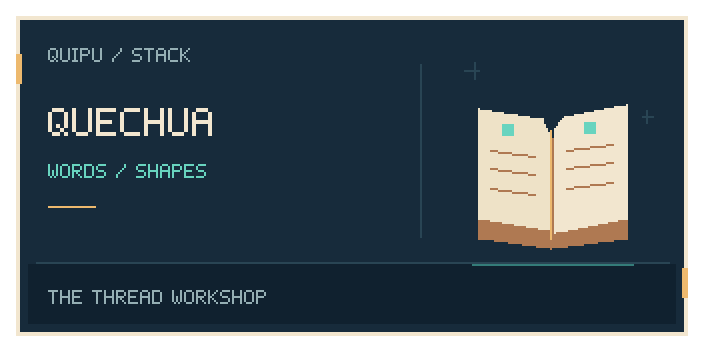

<p align="center"></p>

# Quechua

Shared vocabulary and SHACL shapes for the Quipu stack. Reuse public terms,
validate the shape of knowledge, and preserve stable namespace identifiers.

## Why you would want it

- **Use shared terms:** reuse public vocabulary instead of inventing incompatible names.
- **Validate incoming knowledge:** select SHACL shapes for your data's profile.
- **Keep identifiers stable:** inspect alignments before changing a consumer's vocabulary.

## Install

```sh
curl -fsSL https://raw.githubusercontent.com/scbrown/quechua/main/install.sh | sh
```

Python 3.9+, curl, and a Linux or macOS shell. Downloads and verifies the latest vocabulary and shapes into
`~/.local/share/quechua/TAG`. Releases that include the read-only orientation CLI also install `quechua prime`
under `~/.local/bin`. Older pinned releases remain data-only.

Set `STACK_INSTALL_ROOT` on the receiving shell for another prefix.
Pinned releases, alternatives, configuration and removal are in the
[installation and usage reference](docs/installation-reference.md).

## First success in three commands



Quechua supplies the shape; Quipu validates the two public fixtures locally.
No graph is loaded or changed. [Read the transcript](docs/demos/terminal/transcript.txt)
or [reproduce the recording](docs/demos/terminal.md).

Inspect the vocabulary and shape files without loading a running graph:

```sh
ls "$HOME/.local/share/quechua"/v*/*.ttl
```

Choose the required shapes from the [vocabulary guide](docs/installation-reference.md)
before admitting data. Installing files does not change your graph.

## On your own data

Choose terms in the [catalog](https://intigraph.github.io/quechua/ns)
and shapes from the [vocabulary guide](docs/installation-reference.md#shapes).
The terminal fixture demonstrates a missing-label rejection followed by a
conforming entity. Apply the shapes to a local copy of your own data before
loading them into a live consumer. Installing vocabulary files does not enable
validation or migrate identifiers.

## Wire it into your agent

Run `quechua prime` (`--brief`, `--json`, or `--static`) to find terms and inspect
the vocabulary release version. It does not load or modify a graph. See the
[primer](docs/prime.md) and [skill](skills/quechua/SKILL.md). From a source checkout,
use `python3 scripts/prime.py prime`. Quechua supplies vocabulary and shapes;
your graph tool owns loading and validation.

## Before you start

The installer needs Python 3.9+, curl and a Linux or macOS shell. A validator
such as Quipu is needed to apply SHACL shapes. Select the profile for your
records and check compatibility before loading alignments or changing namespaces.
Data-only pinned releases do not include the orientation CLI.

## What's next

- [The Quechua book](https://intigraph.github.io/quechua/): concepts and usage.
- [Installation reference](docs/installation-reference.md): configuration and removal.
- [Reproduce the terminal demo](docs/demos/terminal.md): local fixture and full output.

### Related tools and repository knowledge

- [Tambo](https://github.com/scbrown/tambo): guided stack installation and verification.
- [Camayoc](https://github.com/scbrown/camayoc): governed memory and vocabulary.
- [Detailed examples and agent setup](docs/installation-reference.md).

**Load this repository’s graph:** public repository-pendant assets have not yet been verified. When a release supplies the archive, checksum and provenance, follow the [verified import workflow](https://scbrown.github.io/quipu/sharing/index.html): extract the share directory and use `quipu import SHARE_DIR --db repository.db`. Import stages knowledge; ROOT stays unchanged.

## 🧺 The stack

<!-- stack-table:start -->

The Quipu stack is built around a governed, bitemporal knowledge store: shared
facts, decisions and work history your agents can query. Quipu can check writes
against your rules, records where each fact came from, and answers what was true
when.

| tool | what it gives your agents |
|---|---|
| [tambo](https://github.com/intigraph/tambo) | 🧰 Agent Platform Toolkit - installs and configures the quipu stack |
| [quipu](https://github.com/scbrown/quipu) | stores shared facts with provenance and history; can check writes against your rules |
| [camayoc](https://github.com/scbrown/camayoc) | prepares knowledge and vocabulary for Quipu, with checks before it is admitted |
| [quechua](https://github.com/scbrown/quechua) | shared vocabulary and shapes for interoperable knowledge |
| [chaski](https://github.com/scbrown/chaski) | reacts to graph changes and delivers governed notifications |
| [bobbin](https://github.com/scbrown/bobbin) | indexes your codebase and injects context from that index and Quipu knowledge |
| [yupana](https://github.com/scbrown/yupana) | shows code impact and can read policies from Quipu to govern agent actions |
| [desire-path](https://github.com/scbrown/desire-path) | turns agent mistakes into feature requests; works on its own without Quipu |
| [seeds](https://github.com/scbrown/seeds) | a work item tracker backed by the Quipu knowledge base |
| [shantytown](https://github.com/scbrown/shantytown) | runs crews of AI agents on work items, triggered by hand, on a schedule or by events; can share work and memory through Quipu |
| [rikuy](https://github.com/scbrown/rikuy) | live brief: status, graphs, watches and signed decisions over Quipu |
| [shuttle](https://github.com/scbrown/shuttle) | runs signed agent workflows and keeps their records in Quipu |

<!-- stack-table:end -->

## Contributing

See the repository tests and documentation checks before submitting a change.

## 📜 License

[License](LICENSE).
